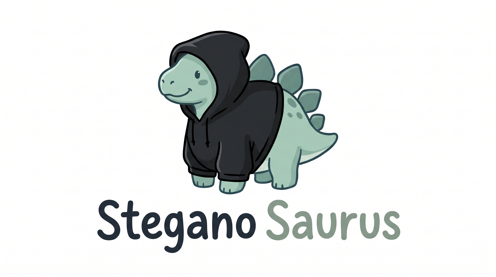

<p align="center">
  
</p>

<h1 align="center">steganosaurus</h1>

<p align="center">
  <strong>Steganografie-Analyse für CTF-Spieler – eine statische Binary statt zehn Einzeltools.</strong>
</p>

`steganosaurus scan` erkennt den Dateityp, führt alle passenden Analysen aus, steigt rekursiv in
extrahierte Daten ein und hebt Flags wie `THM{…}` oder `HTB{…}` hervor. Gebaut für TryHackMe,
HackTheBox und picoCTF.

> Status: früh in Entwicklung (Meilenstein M1 – Grundgerüst). Siehe [Spezifikation](docs/SPEC.md) und [Backlog](docs/BACKLOG.md).

## Installation

```sh
go install github.com/schmid-di/steganosaurus/cmd/steganosaurus@latest
# oder aus dem Repo
make build   # → bin/steganosaurus
```

## Nutzung

```sh
steganosaurus scan challenge.png                 # Auto-Triage
steganosaurus scan -v challenge.png              # alle Funde, volle Details
steganosaurus scan -q --stop-on-flag image.jpg   # nur Flags ausgeben
steganosaurus scan --json file.wav               # JSON für Skripte
steganosaurus scan --flag-format 'DUCTF\{[^}]+\}' file.bmp
```

Artefakte und `report.json` landen in `./<datei>_steg/` (änderbar mit `-o`).

Exit-Codes: `0` kein Flag · `1` Fehler · `2` Flag gefunden

## Entwicklung

```sh
make test    # Tests mit Race-Detector
make lint    # go vet + staticcheck
make cross   # Release-Binaries für linux/darwin/windows × amd64/arm64
```

Neue Analyzer implementieren `engine.Analyzer` in einem eigenen Paket unter `internal/analyzer/`
und werden in `internal/analyzer/analyzer.go` registriert.
